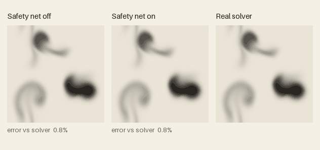
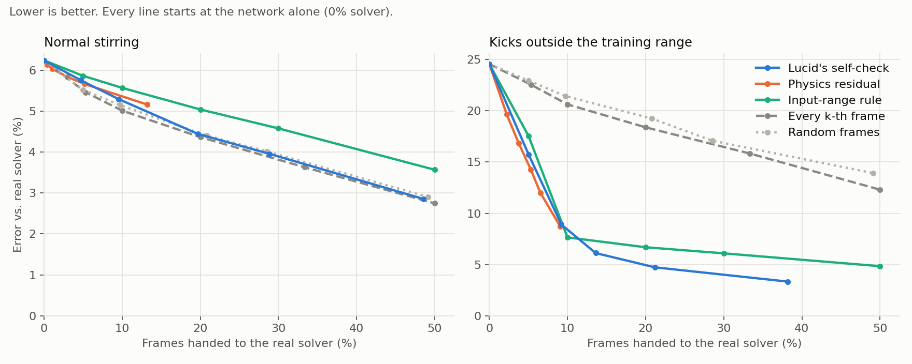

# Lucid

**A 5 MB neural network that runs a fluid simulation, and knows when it's wrong.**

**[Try it in your browser](https://maxwell-khavari.github.io/lucid/)**: drag to stir, press Kick, and flip the safety net off to watch it break.



## At a glance

| | |
|---|---|
| **4x less error** | when the fluid is pushed outside anything it trained on: 24.6% falls to 6.1% |
| **14% of frames** | is all it hands to the real solver to get there |
| **0.99 AUROC** | at ranking its own worst frames, learned with no physics rules written in |
| **3x better** | than spending the same solver budget on random or scheduled frames (about 20% error) |
| **5 MB, 60 fps** | in a browser tab, with no server and no install |
| **2.3 hours** | to train from scratch on a single Apple M4, with zero external data and zero downloads |

## Why this matters

Neural surrogates are replacing slow simulators in weather forecasting, engineering CFD, chip thermals and digital twins. They are fast, and they share one dangerous habit: when the input drifts outside what they learned, they keep producing confident, plausible output that is wrong. Nothing raises a flag.

Lucid shows the fix as a working thing you can touch. The network predicts its own error, frame by frame. When that prediction says it's out of its depth, it defers to the trusted method for that frame. Everything else stays fast.

You can watch this happen in the GIF above. A strong stir hits all three panes. The unprotected network glitches and never fully recovers. The protected one catches the moment, hands that frame to the solver, and stays locked to the truth.

## Results



The evaluation uses held-out episodes: 24 episodes of 150 frames each, in `results/eval.json`, and every number is reproducible.

**Pushed outside the training range** (sudden strong stirs on 10% of frames):

| Gate | Solver frames | Error vs real solver |
|---|---|---|
| Network alone | 0% | 24.6% |
| **Lucid's self-check** | **14%** | **6.1%** |
| **Lucid's self-check** | **21%** | **4.7%** |
| Random frames | 21% | 19.2% |
| Every k-th frame | 20% | 18.4% |
| Physics residual (velocity divergence) | 9% | 8.7% |
| Hand-written "input out of range" rule | 20% | 6.7% |

**Normal stirring:** the network is accurate on its own, at 0.6% error per frame and 6.2% averaged over 150 frames.

**Baselines, stated plainly:**
- Below a 10% budget, the physics residual check matches or slightly beats the self-check.
- At exactly 10%, the hand-written rule is ahead, because it was built for this exact disturbance.
- Under normal stirring, the self-check is no better than a fixed schedule, because there is nothing unusual to catch.
- From about 14% upward, the self-check gives the lowest error of every gate tested, and nobody had to write a rule for the failure.

## What you can do with it
- **Play with it:** [live demo](https://maxwell-khavari.github.io/lucid/), on desktop or phone.
- **Use the weights:** `weights/lucid.pt` (PyTorch) or `web/lucid.onnx` (any ONNX runtime). Both are 4.9 MB.
- **Test your own gate:** add a scoring function to `SCORES` in `eval/evaluate.py`. It is compared against every baseline on the same episodes.
- **Reproduce everything:** follow the commands below.

## How it works
1. **Solver.** `sim/solver.py` and `sim/solver.js` implement stable fluids (Stam 1999) on a 64x64 periodic grid: 4 substeps per frame, 80 Jacobi pressure iterations each. A test checks the Python and browser versions agree to within 1e-4.
2. **Data.** Random stirrers (`sim/forcing.py`) drive the solver while training runs. No dataset is stored or downloaded.
3. **Model.** `lucid/model.py` is a 1.2M-parameter U-Net with circular padding and two heads:
   - the next frame's change
   - the per-cell error of that prediction
4. **Training.** `train.py` feeds the network true solver states, plus states it drifted into by rolling itself forward. That way the error head learns what the network's own mistakes look like.
5. **Gate.** The score is the predicted error divided by the flow's size. Above the threshold, the real solver takes the frame.

## Reproduce
```bash
pip install torch numpy matplotlib onnx onnxruntime
python3 -m unittest discover tests              # JS and Python solvers agree
python3 train.py --steps 24000                  # ~2.3 h on an M4, writes ckpt/lucid.pt
python3 -m eval.evaluate                        # ~35 min, writes results/eval.json
python3 -m eval.plots                           # writes results/headline.png
python3 -m eval.gif                             # writes results/demo.gif
python3 -m export.onnx                          # writes web/lucid.onnx, checks it against PyTorch
python3 -m http.server 8000                     # then open http://localhost:8000/web/
```

## Use the model
```python
import torch
from lucid.model import Lucid

model = Lucid()
model.load_state_dict(torch.load("weights/lucid.pt", map_location="cpu")["model"])
model.eval()
x = torch.zeros(1, 6, 64, 64)            # (u, v, d, fx, fy, s)
y = model(x)                             # (next u, next v, next d, predicted error per cell)
```

## Limits
- **No speedup at this size.** At 64x64 the classical solver is about as fast as the network. Surrogates save compute where the real method is expensive, such as 3D, high resolution or weather. The self-check pattern carries over to those settings, but this repo does not demonstrate it there.
- **A toy 2D fluid.** It is not validated for any real-world use. See [MODEL_CARD.md](MODEL_CARD.md).
- **The self-check is a signal, not a guarantee.** A low predicted error does not prove the output is right.

## Credits and scope

Lucid is a technical project. It measures and demonstrates how well a small surrogate can judge its own output, and what that judgement buys when deciding when to call a trusted solver.

**It does not claim novelty.** Pairing a learned surrogate with a fallback to a classical solver, triggered by an error or residual signal, is established in prior work. Lucid's contributions are practical:
- an open, reproducible implementation
- a side-by-side comparison of gating strategies
- a version anyone can run in a browser

Prior work this builds on:
- J. Stam, *Stable Fluids*, SIGGRAPH 1999. The reference solver.
- XRePIT (arXiv:2510.21804). A deep-learning and CFD hybrid in OpenFOAM that falls back to the solver when a residual crosses a threshold.
- Hybrid Neural-MPM (arXiv:2505.18926). A real-time neural fluid that falls back to a classical MPM solver.
- Hybrid Neural World Models (arXiv:2605.28317). Uses a surrogate's error map to gate a reference-solver fallback.
- A. Graves, *Adaptive Computation Time for Recurrent Neural Networks*, 2016, and related work on learning when to spend compute.

Lucid is independent and is not affiliated with or endorsed by any of these authors.

## License and disclaimer

Copyright 2026 Maxwell Khavari. Code and weights are licensed under the **[PolyForm Noncommercial License 1.0.0](LICENSE)**.
- **Free:** personal use, research, education and nonprofit use.
- **Commercial use:** needs written permission.

This is a research demo of a toy 2D fluid. It is provided **as is, without warranty of any kind**. As far as the law allows, the author is not liable for any damages arising from its use. It is not validated for, and must not be used for, engineering, safety, medical, financial or any other real-world decision.
